<div align="center">

<!-- Animated Data Center / NOC Hero Banner -->


<br />

<!-- Dynamic Terminal Typing Line -->
<a href="https://github.com/JuanCan00">
  
</a>

<br />

<!-- Pro Contact & Profile Pills -->
<a href="https://www.linkedin.com/in/juancan00">
  
</a>
<a href="https://github.com/JuanCan00?tab=repositories">
  
</a>


</div>

<br />


## `01 //` System Overview — Perfil Técnico

```yaml
node_profile:
  engineer:   "Juan Pablo Cano (@JuanCan00)"
  degree:     "Ingeniería en Telecomunicaciones"
  university: "Universidad Militar Nueva Granada — Colombia"
  focus:
    - "Arquitectura de Redes, Teletráfico TCP/IP y Comunicaciones Digitales"
    - "Infraestructura Cloud, Sistemas Escalables y Despliegue Edge"
    - "Procesamiento Digital de Señales (FFT) y Sistemas Embebidos (RP2040)"
    - "Simulación Científica 3D (WebGL/Three.js) y Aplicaciones Web Modernas"
  status:     "ONLINE · Construyendo soluciones de ingeniería y software"
```

<br />


## `02 //` Infrastructure & Tech Stack

<div align="center">

#### `CORE //` Lenguajes & Sistemas


<br /><br />

#### `EDGE & WEB //` Frontend, 3D & Cloud


<br /><br />

#### `TELEMETRY & DSP //` Análisis de Señales, Redes y Datos

<p>
  
  
  
  
  
  
</p>

</div>

<br />


## `03 //` Deployed Nodes — Proyectos Públicos Destacados

<table>
  <tr>
    <td width="50%" valign="top">
      <h3><code>NODE-01</code> · <a href="https://github.com/JuanCan00/Proyecto_Analisis_Senales">Análisis de Señales (Imitation &amp; Reverse)</a></h3>
      <p>Ocultamiento y recuperación espectral de cinco audios mediante permutación biyectiva de coeficientes complejos de Fourier (<code>rfft</code> / <code>irfft</code>) con generación de claves CSV.</p>
      <p>
        
        
        
      </p>
      <p>🔗 <a href="https://github.com/JuanCan00/Proyecto_Analisis_Senales">Ver repositorio</a> · <a href="https://github.com/JuanCan00/Proyecto_Analisis_Senales/blob/main/EXPLICACION_IMITATION.md">Explicación matemática</a></p>
    </td>
    <td width="50%" valign="top">
      <h3><code>NODE-02</code> · <a href="https://github.com/JuanCan00/laboratorio-levitacion-magnetica">Laboratorio Virtual de Levitación 3D</a></h3>
      <p>Simulación física interactiva en tiempo real del <strong>Levitron</strong> y un <strong>Tren Maglev</strong> en unidades SI, renderizado WebGL con Three.js, animaciones GSAP y suite automatizada de pruebas.</p>
      <p>
        
        
        
      </p>
      <p>🟢 <a href="https://juancan00.github.io/laboratorio-levitacion-magnetica/">Demo en vivo</a> · <a href="https://github.com/JuanCan00/laboratorio-levitacion-magnetica">Ver repositorio</a></p>
    </td>
  </tr>
  <tr>
    <td width="50%" valign="top">
      <h3><code>NODE-03</code> · <a href="https://github.com/JuanCan00/Teletrafico_Cliente_Servidor">Teletráfico TCP Cliente-Servidor</a></h3>
      <p>Pipeline de análisis de capturas Wireshark (<code>.pcapng</code> / <code>.csv</code>): aislamiento de flujos, descomposición de RTT, clasificación de ACKs (<em>Piggybacking</em>, <em>Delayed</em>) y generación de reportes Excel y gráficas.</p>
      <p>
        
        
        
      </p>
      <p>🔗 <a href="https://github.com/JuanCan00/Teletrafico_Cliente_Servidor">Ver repositorio y gráficas</a></p>
    </td>
    <td width="50%" valign="top">
      <h3><code>NODE-04</code> · <a href="https://github.com/JuanCan00/HammingTx">HammingTx — Transmisor Embebido</a></h3>
      <p>Firmware C++/Arduino (RP2040) que lee el acelerómetro <strong>MPU6050</strong> vía I2C, codifica 16 → 28 bits con <strong>Hamming(7,4)</strong>, muestra nibbles en OLED SH1106 y transmite por UART a analizador lógico.</p>
      <p>
        
        
        
      </p>
      <p>🔗 <a href="https://github.com/JuanCan00/HammingTx">Ver repositorio y captura lógica</a></p>
    </td>
  </tr>
</table>

<details>
  <summary><strong>📂 Ver más nodos públicos (MATLAB, Web Interactiva y Demos Académicas)</strong></summary>
  <br />

| Nodo | Proyecto | Descripción | Enlace |
| :---: | :--- | :--- | :---: |
| `LAB-01` | **[ComunicacionesDigitales](https://github.com/JuanCan00/ComunicacionesDigitales)** | Script MATLAB para análisis de muestreo, correlación cruzada (`xcorr`) y espectro FFT. | [Repo](https://github.com/JuanCan00/ComunicacionesDigitales) |
| `WEB-01` | **[birthday](https://github.com/JuanCan00/birthday)** | Web interactiva *glassmorphism* con fuegos artificiales en Canvas, galería táctil y audio. | [Demo](https://juancan00.github.io/birthday/) |
| `WEB-02` | **[HappyBirthday](https://github.com/JuanCan00/HappyBirthday)** | Validación interactiva de cumpleaños con Canvas de partículas y cinta fotográfica. | [Demo](https://juancan00.github.io/HappyBirthday/) |
| `EDU-01` | **[Serie Presentación Software](https://github.com/JuanCan00/PresentacionSoftware2)** | Demostración progresiva en 3 etapas de diseño HTML5 y CSS Flexbox ([0](https://github.com/JuanCan00/PresentacionSoftware0) · [1](https://github.com/JuanCan00/PresentacionSoftware) · [2](https://github.com/JuanCan00/PresentacionSoftware2)). | [Demo](https://juancan00.github.io/PresentacionSoftware2/) |

</details>

<br />


## `04 //` Live NOC Telemetry — Estadísticas en Tiempo Real

<div align="center">

<a href="https://github.com/JuanCan00">
  
</a>

<br /><br />

<p>
  
  &nbsp;
  
</p>

<p>
  
</p>

</div>

<br />

<!-- Animated Network Footer -->
<div align="center">
  
</div>
